<a href="https://github.com/MarcussRico"><picture><source media="(max-width: 600px)" srcset="assets/hero_phone.svg"></picture></a>

<a href="mailto:saianandro@gmail.com"><b>saianandro@gmail.com</b></a> &nbsp;·&nbsp; Chennai, India &nbsp;·&nbsp; open to AI engineering roles and research collaborations

I learn a method by building it until it matches the reference to float precision, then I use it on messy real data: RNA-binding sites, rPPG pulse signals, Sentinel-2 imagery, access-review logs. I care about the parts people skip: honest baselines, one variable at a time, and writing down what didn't work.

## From first principles

**[backprop-from-scratch](https://github.com/MarcussRico/backprop-from-scratch)** came before the autograd engine: every layer's backward pass derived on paper and coded by hand in NumPy, then checked against finite differences (largest relative error 4.9 × 10⁻¹⁰). **[multiple-linear-regression-numpy](https://github.com/MarcussRico/multiple-linear-regression-numpy)** is closed-form least squares from the derivation.

## Research

Attention weights are often read as an explanation. I trained the same CNN–BiLSTM–attention model on four benchmarks built from the same ENCODE PUM2 peaks, changing only two conventional design choices. How often attention points at the protein's known motif moved from 0.398 to 0.955, and a causal occlusion test showed the model relies on the motif in every design. So the low score is genuine unfaithfulness, created by the benchmark, not by the model. In the best design, attention and Integrated Gradients are statistically indistinguishable (p = 0.43). [Code, data and logs →](https://github.com/MarcussRico/PUM2-attention-vs-IG)

## Shipped systems

| | What it does | Highlights |
|---|---|---|
| **[Warden](https://github.com/MarcussRico/warden)**  Freshworks hackathon | Access reviews for Freshservice that actually review: a rules engine, AI agents whose quotes are verified by code, a second agent that argues back, role-based decisions | **182 / 182** planted risks found, **0** false alarms. The rules engine alone catches 159; AI handles only the 23 that need reading a ticket. [Live](https://warden-psi-mauve.vercel.app) |
| **[Allowance](https://github.com/MarcussRico/allowance)**  PayPal AI Hackathon | Spending limits for AI agents: a Claude agent with three strict tools pays through PayPal Vault and Orders inside caps the owner sets, and holds anything else for a press-and-hold approval. Also an MCP server | Limits enforced by the rules engine, not by trusting the model; idempotent charges. [Live](https://allowance-23yv.onrender.com) |
| **[ANAMNESIS](https://github.com/MarcussRico/anamnesis-medical-chatbot)** | Bayesian symptom triage that asks the yes/no question with the highest expected information gain, with no generative model anywhere | **96.3%** correct after about **4** questions (random questions: 79.4% after 7.9); calibration error 0.035; found that all 41 official test rows also appear in training. [Live](https://anamnesis-theta.vercel.app) |
| **[physio-forensics](https://github.com/MarcussRico/physio-forensics)** | Deepfake detection that never asks whether a face looks fake: it checks for one shared cardiac pulse, with the right transit delays, across four skin regions (rPPG) | A generator can fake a pulse in one patch; phase coherence across the forehead, cheeks and an untouched neck is much harder. [Demo](https://github.com/MarcussRico/physio-forensics-website) |
| **[FLIGHTLINE](https://github.com/MarcussRico/flightline)**  Smart India Hackathon, SIH26249 | A fleet availability twin: joins health monitoring, records, spares and MRO into one graph, simulates the fleet day by day and optimises sortie-days with CP-SAT | Offline and deterministic; a scenario re-solves in about a second; 77 tests |
| **[LedgerLens](https://github.com/MarcussRico/LedgerLens)** | Procurement forensics: 42 detectors across 5 pillars | Rules and statistics compute; the LLM only explains and drafts |
| **[Deforestation Sentinel](https://github.com/MarcussRico/Deforestation-Sentinel)** | ResNet50 fine-tuned on EuroSAT, run on real Sentinel-2 tiles over Rondônia, Brazil | **95.26%** test accuracy; 10 of 72 patches flagged forest → non-forest (about 410 ha) |

## A year of work

Redrawn every morning from the live contribution calendar by <a href=".github/workflows/contrib3d.yml">a workflow</a>; the figures are generated by <a href="tools">tools/</a> from real runs and results.

## How I work

<table>
<tr>
<td width="50%" valign="top">

**Baselines before optimisation.** Get the simplest version working end to end before tuning anything.

**One variable at a time.** If two things changed between two results, the comparison is noise.

**Write down what didn't work.** The failed run is data.

</td>
<td width="50%" valign="top">

**Honest numbers over impressive ones.** If a result looks too good, the first suspect is the eval, not the model.

**Read the paper, then read the code.** They disagree more often than people admit.

**Ship what survives real data.** Clean benchmarks are a starting point, not the goal.

</td>
</tr>
</table>

<b>Earlier projects</b>

 

| Project | What it does | Stack |
|---|---|---|
| **Data Analysis Harness** | An agent harness for exploring unseen datasets: sandboxed execution, long-horizon memory, self-healing tool calls, approval gates | Python, tool calling |
| **Recipe scraper** | About 1,000,000 recipes collected and structured as a RAG corpus for a food-focused LLM app | Python, BeautifulSoup |
| **Aide** | A daily assistant: function-calling tools, whiteboard photo to tasks, neural TTS | FastAPI, Groq, SQLite |
| **Medical RAG chatbot** | Retrieval-augmented QA over medical literature with cited answers | LLaMA 3.3, Groq, Pinecone, LangChain |
| **Vision** | Gesture-controlled mouse, sign-language CNN, monocular depth with MiDaS | MediaPipe, OpenCV, TensorFlow, PyTorch |
| **Games** | Unity titles in C#, browser games in JavaScript, 3D assets | Unity, C#, JS, Blender |

Outside the terminal: speedcubing, swimming, chess.

